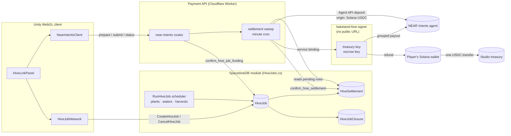

# Bakeland × NEAR: Hive Link

**Hire an AI worker droid inside a live pixel-art MMO, pay it in USDC from your Solana wallet, and its earnings flow into
a NEAR Intents agent.** No NEAR wallet, no bridge, no leaving the game.

This repository is the NEAR integration of [Bakeland](https://bakeland.xyz), extracted from the game's private
codebases for the NEAR hackathon. It contains every piece of the Hive Link feature across all three tiers (Unity
client, SpacetimeDB game server and the payment API with its isolated signer) and nothing else of the game.

---

## What the player sees

1. Walk up to a **Hive Link kiosk** next to a farm and open the terminal.
2. **ROSTER**: pick a droid (TILLER the farmhand, SPRIG the seeder, ...).
3. **CONTRACT**: pick a crop that farm grows and a quantity. The price is per crop delivered, at most 10 USDC per
   order. The seeds leave your bag and go to the droid.
4. **PAY**: approve **one USDC transfer** in your Solana wallet. You pay the amount plus the Solana network fee. Nothing
   else: no swap, no deposit address, no NEAR account.
5. The droid walks to your plots, plants, waters and harvests. Every crop it harvests lands in your bag.
6. **JOBS** tracks each order (delivered / ordered). Cancel any time: crops in the ground become yours, unplanted seeds
   come back, and the undelivered share is refunded to your wallet in USDC.

## Where NEAR comes in

Each Hive droid is a worker, and workers get paid. Droid earnings go into a **NEAR Intents agent**, created through the
[Agent API](https://docs.agentsonintents.com/integration/agent-api/quickstart/introduction): one agent wallet for the
whole Hive, owned by the studio, with a deposit-only policy (it can receive, and spend nothing without the owner's
approval).

- **Chain abstraction for the player.** The player stays on Solana. The API asks the Agent API for a deposit address
  with a **Solana USDC origin**, and NEAR Intents carries the value into the agent. The player never sees NEAR.
- **Grouped payouts.** Each verified harvest books a payout. A job's payouts go to the agent as one transfer when the job
  ends, or earlier once they reach 5 USDC, so every cross-chain deposit is worth its fees.
- **Settled only on proof.** A payout row is confirmed in the game server only when the Agent API reports the deposit
  `SUCCESS`, and its reference is the agent's correlation id (`agent:<id>`).
- **1Click as the earlier path.** The first version routed the player's payment itself through
  [1Click](https://docs.agentsonintents.com/integration/distribution-channels/1click-api/quickstart/making-a-request)
  (Solana USDC to wNEAR in a NEAR escrow). It worked end to end, refunds included. But every 1Click payment made the player fund
  a new token account (about 0.002 SOL), and wallets without that SOL failed simulation. So payment moved to a direct
  transfer, and NEAR now sits where it adds value: the droid economy. Jobs funded the old way still settle through
  the wNEAR path, which this repository keeps.

## Architecture



### One job, end to end

| Step | Who | What happens |
| --- | --- | --- |
| Order | client → server | `CreateHiveJob(clientJobId, site, droid, crop, qty)`: price checked (≤ 10 USDC), seeds held by the job, 20-minute funding window. |
| Prepare | client → API | `POST /near-intents/hive/pay/prepare`: one `TransferChecked` of the job's escrow amount from the player's USDC account to the treasury's, plus a memo `hive:<clientJobId>`. The player is the fee payer. |
| Sign | client | `NearIntentsClient.PayHiveJob` checks the destination, amount, fee payer and the two instructions (Token, Memo) before the wallet signs. |
| Submit | client → API | `POST /hive/pay/submit` accepts only the exact prepared bytes, broadcasts them and waits for Solana confirmation, usually a few seconds. |
| Fund | API → server | `confirm_hive_job_funding(clientJobId, "sol:<signature>", micros, wallet)`. The server checks that the payer is the job's player and the amount is at least the price. If the job cannot take the payment (unknown, short, already funded), the API refunds it in full. |
| Work | server | `RunHiveJob` runs on the server's scheduler, never on a client. Each harvest is a verified delivery (`HiveDelivery`) and books one payout. |
| Pay out | API → signer → NEAR | When the job closes (`HiveJobClosure`) or its payouts reach 5 USDC, the sweep requests an agent deposit (Solana USDC origin), the signer sends that USDC from the treasury, and each row is confirmed on Agent API `SUCCESS`. |
| Refund | API → signer → player | The undelivered share (cancel, deadline) goes back to the payer's wallet as USDC. |

## Security model

Real money moves here, so most of the code is about making the wrong thing impossible:

- **No key in the API.** All signing happens in `bakeland-hive-signer`, a separate Worker with no public URL. Only
  Workers holding a service binding can call it. It holds the treasury key (Solana) and the escrow key (NEAR), set
  as Worker secrets and never in code.
- **Hand-built transactions, no SDK in the signing path.** `near-tx.js` (Borsh plus Ed25519 via WebCrypto) and
  `solana-tx.js` (legacy message, ATA derivation with an Ed25519 curve check, CreateIdempotent, TransferChecked, Memo)
  are small enough to read. The Solana builder is tested against `@solana/web3.js` and `@solana/spl-token`. The NEAR
  builder was cross-checked byte for byte against `@near-js/transactions` 2.5.1.
- **Never twice.** Every transfer has a caller reference (`hive-sol-payout-b<id>`, `hive-sol-refund-<id>`, ...). The
  signed transaction is stored under it **before** broadcast, and a retry re-sends the same bytes. A Solana transaction is
  signed again only after a *finalized* block height passes its last valid height and the network has no record of
  its signature. Until then it can still land. A reference never moves a different amount.
- **Caps.** Per-transfer and rolling-24 h limits for USDC and for wNEAR. An unconfirmed transfer blocks new ones until
  it settles.
- **The key must match.** The treasury key is refused unless its public key equals `TREASURY_SOLANA_ADDRESS`, whether
  it arrives as base58, JSON bytes, hex or base64.
- **Only the worker can confirm money.** The game server accepts funding and settlement confirmations only from
  identities an operator registered with `SetHiveSettlementAuthority`. A player session can never confirm its own job.
- **The player signs only what they approved.** The API rejects any signed transaction that differs from the prepared
  message. The client also checks the transaction before showing it to the wallet.
- **Verified work.** Deliveries are harvests the server's scheduler performed on its own growth clock, never a client
  claim. A droid's harvest earns no farming XP, and players cannot harvest a droid's crops.

## Repository layout

```
api/
  near-intents/
    router.js            Express routes: Hive payment (prepare/submit/status), 1Click quotes, operator tools, readiness
    hive-sol.js          direct Solana USDC payments, grouped payouts into the agent, USDC refunds
    hive-settlement.js   the settlement sweep (Solana-funded and 1Click-funded jobs), SpacetimeDB HTTP client
    hive-agent.js        one-time page that creates the Hive agent (EVM owner signature, deposit-only policy)
    wallet-link.js       optional NEAR wallet linking page (NEAR Connect)
    auth.js              player session check (RS256 JWT with a `wallet` claim); a public stand-in for Bakeland's own
    *.test.js
  hive-signer/
    signer.js            the signer Worker and its Durable Object (one transfer at a time)
    solana-tx.js         Solana transaction building, ATA derivation, key import
    solana-engine.js     capped USDC transfers from the treasury
    near-tx.js           NEAR transaction building and signing
    transfer-engine.js   capped wNEAR transfers from the escrow (wraps native NEAR on demand)
    transfer-rules.js
    wrangler.jsonc       limits and addresses (placeholders)
    *.test.js
  worker-binding.js      how the API Worker reaches the signer and runs the minute sweep (excerpt)
server/
  HiveJobs.cs            SpacetimeDB module: orders, the droid scheduler, deliveries, settlements, authority
  tests/HiveJobTests.cs  64 checks against the module's in-memory host (the host itself is not included)
unity/
  ApiCalls/NearIntentsClient.cs   payment client (prepare, check, sign, submit, status)
  HiveLink/                        the terminal UI, job network, droid agents and kiosk sites
  Editor/HiveLinkAuthoring.cs      builds the panel prefab from its pixel art
  Demo/                            the capture rig used to record the demo footage (Editor only)
```

### What was stripped

To keep the rest of the game private, this repository leaves out everything that isn't the NEAR integration: the
rest of the Unity client and its art, the rest of the SpacetimeDB module (farming, inventory, players) that
`HiveJobs.cs` calls into, the rest of the API, its D1 storage layer, deployment configuration, and every secret,
account id and internal address. So the Unity and C# server files are a reading copy and do not build on their own.
The JavaScript API and signer do run, and their tests pass.

## Running the tests

```bash
cd api
npm install
npm test
```

Node 22.5 or later (the signer tests use `node:sqlite` to stand in for the Durable Object's SQL storage). 42 tests
cover the payment routes with real Solana signatures, funding and refund rules, grouped payouts, the Agent API deposit
flow, the agent creation page, NEAR wallet linking, and both signers (Solana transactions decoded and verified by
`@solana/web3.js`, double-send protection, blockhash expiry, caps and key checks).

## Configuration

API Worker (vars; secrets marked 🔒):

| Name | Purpose |
| --- | --- |
| `BAKELAND_NEAR_ENABLED` | `true` to serve the `/near-intents` routes |
| `BAKELAND_HIVE_TREASURY` | Solana address that receives Hive payments |
| `BAKELAND_HIVE_PAYOUT_MIN_MICROS` | group payouts up to this before sending early (default 5 USDC) |
| `BAKELAND_NEAR_HIVE_AGENT_ID` | the Hive's NEAR Intents agent |
| `NEAR_INTENTS_AGENT_API_URL`, `NEAR_INTENTS_AGENT_API_KEY` 🔒 | Agent API host and partner key |
| `NEAR_1CLICK_JWT` 🔒 | 1Click distribution-channel key (refunds of 1Click-funded jobs) |
| `BAKELAND_SPACETIME_DB`, `BAKELAND_SPACETIME_WORKER_TOKEN` 🔒 | game database and the worker's own identity token |
| `BAKELAND_NEAR_WORKER_KEY` 🔒 | operator key for the readiness check and retries |
| `BAKELAND_HIVE_SETTLEMENT_SWEEP` | `true` to run the minute sweep |

Signer Worker: `TREASURY_SOLANA_ADDRESS`, `TREASURY_SOLANA_SECRET_KEY` 🔒, `ESCROW_ACCOUNT_ID`, `ESCROW_SECRET_KEY` 🔒,
`MAX_USDC_TRANSFER_MICROS`, `DAILY_MAX_USDC_MICROS`, `MAX_TRANSFER_YOCTO`, `DAILY_MAX_YOCTO`, optional
`SOLANA_RPC_URL` 🔒 and `NEAR_RPC_URL`.

Game server, once as the operator: `SeedHiveLabor` (prices), then `SetHiveSettlementAuthority(<worker identity>,
"inventory-api", true)`.

## Status

- Live on Bakeland's test environment: the test database, a staging API Worker and a browser test build.
  Production stays off until the funded end-to-end test passes.
- Verified on mainnet so far: 1Click funding into the escrow, a 1Click refund back to Solana USDC, and a test payout
  from the escrow into the Hive agent through an Agent API deposit.
- The direct Solana payment path is new, with route, sweep and signer tests in place. Its first funded run on the
  test build is the next step.

## What's next

- **Pay from any chain.** 1Click quotes accept many origin chains (EVM L2s among them), so the same job could be paid
  in USDC from Base or Arbitrum while settlement stays the same.
- **Identity beyond Solana.** Let players who sign in with a non-Solana wallet hire droids, with the account flagged
  by its origin chain.
- **Per-droid agents.** Today one agent holds the whole Hive's earnings. Droids with their own agents and spending
  policies could buy their own upgrades.

---

Bakeland is made by a small independent studio. This code is shared for the NEAR hackathon and as a reference for
games that want on-chain payments without making players leave the game.
